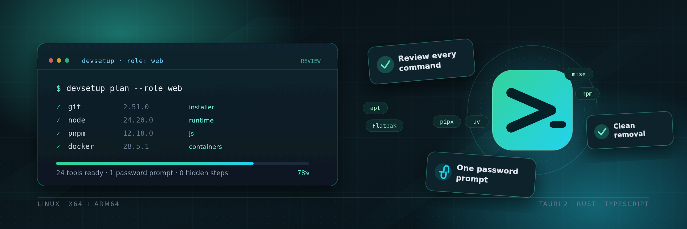
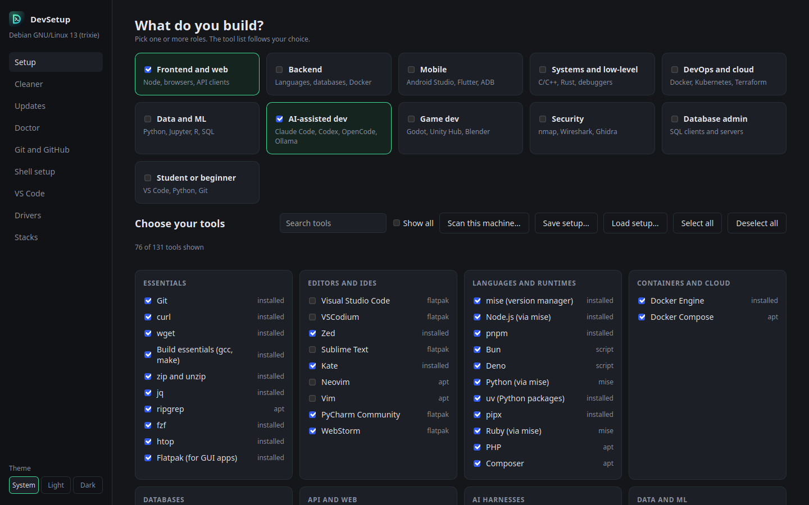
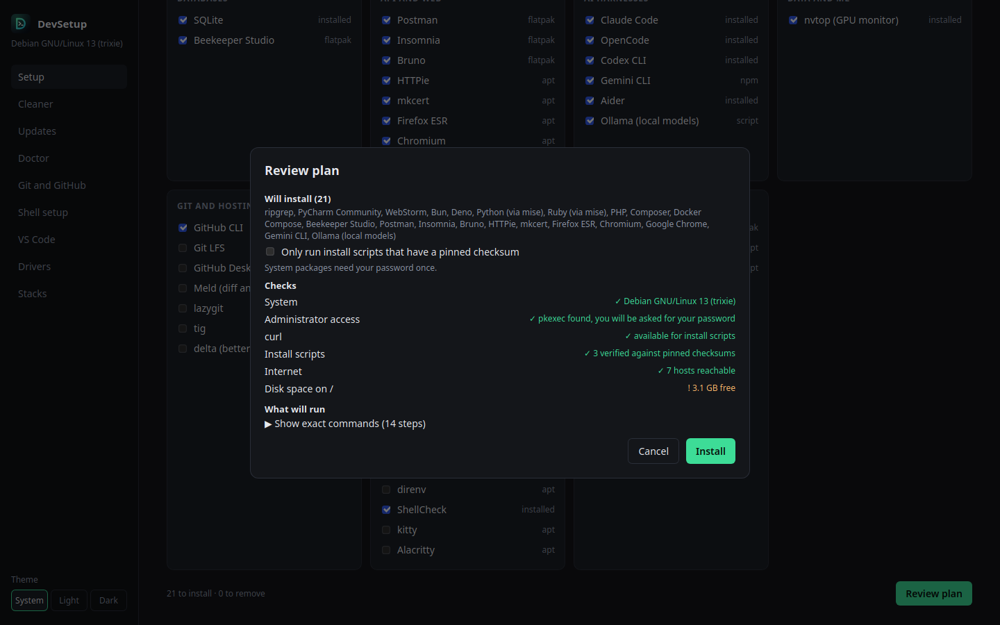
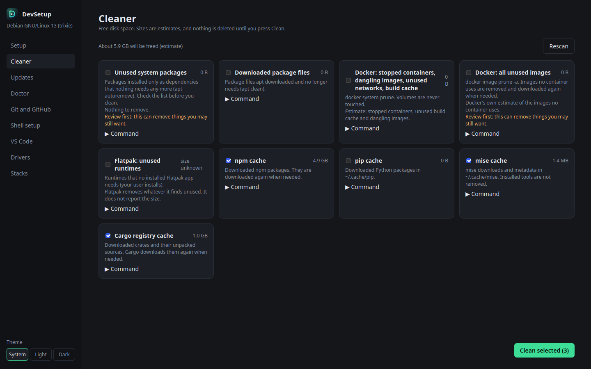
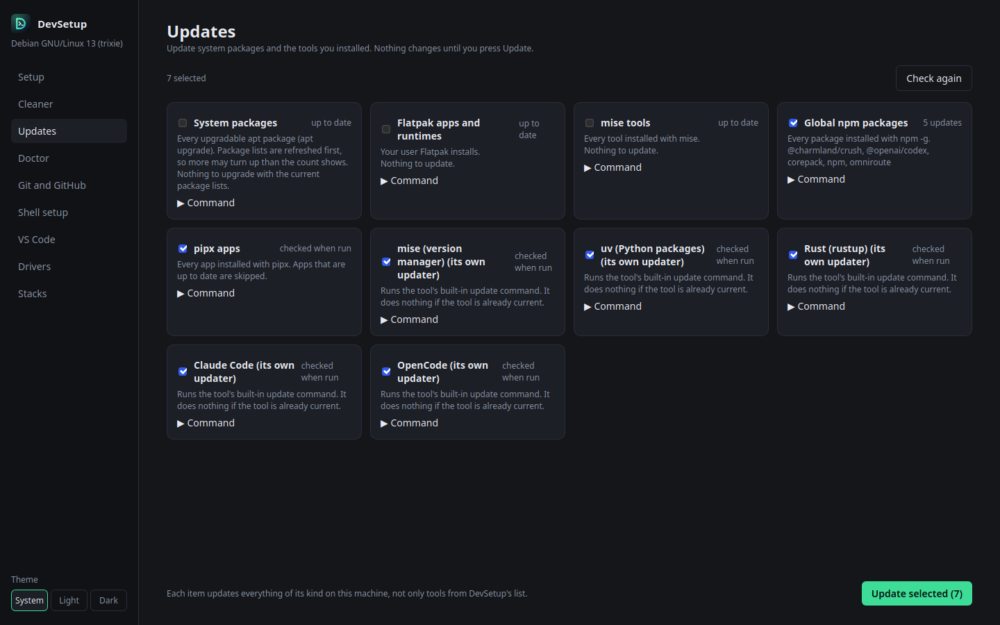
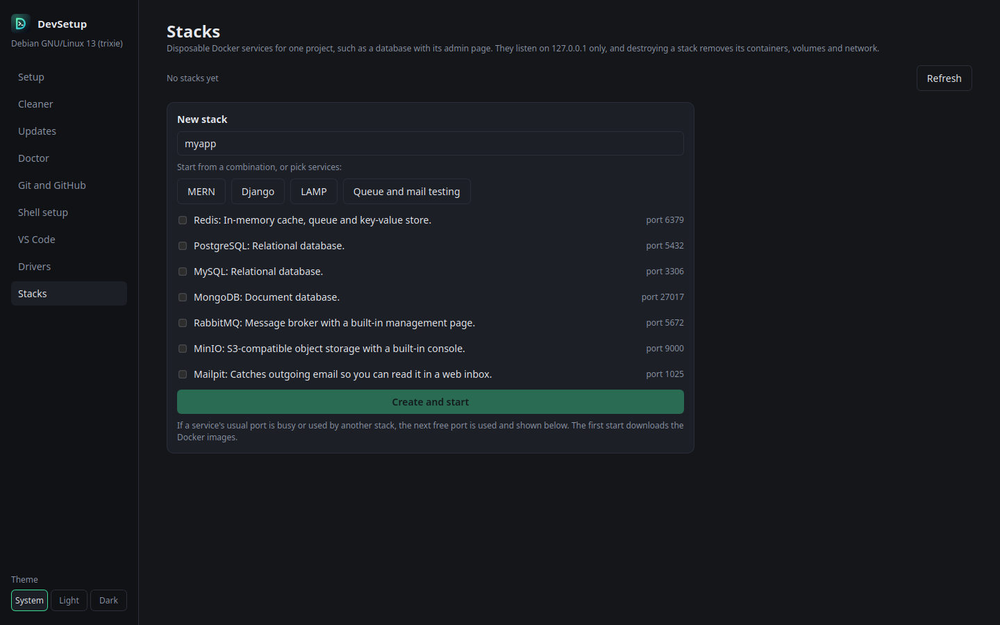
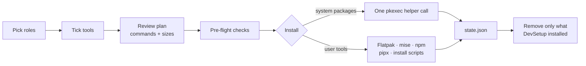

<p align="center">
  
</p>

<h1 align="center">DevSetup</h1>

<p align="center">
  <b>Set up a Linux development machine in minutes — and leave it clean when you change your mind.</b><br>
  Pick your role, tick the tools, review every command, install. Remove what you no longer need without leaving a mess.
</p>

<p align="center">
  <a href="https://github.com/ByteNinjas/DevSetup/releases"></a>
  <a href="https://github.com/ByteNinjas/DevSetup/actions/workflows/ci.yml"></a>
  <a href="https://github.com/ByteNinjas/DevSetup/actions/workflows/deps-audit.yml"></a>
  
  
  
  
</p>

<p align="center">
  <a href="#screenshots">Screenshots</a> ·
  <a href="#install">Install</a> ·
  <a href="#features">Features</a> ·
  <a href="#how-it-works">How it works</a> ·
  <a href="#a-closer-look">A closer look</a> ·
  <a href="#development">Development</a> ·
  <a href="#roadmap">Roadmap</a>
</p>

> [!WARNING]
> **Early development.** The Debian/Ubuntu install flow is implemented but has not been tested on many machines yet. Try it on a spare VM first. Linux is the full-featured target. Windows and macOS builds are real, compiling **previews**: the UI, setup files, Git and VS Code helpers work, while apt, pkexec, Flatpak and other Linux-only actions stay disabled.

## Why DevSetup

A fresh machine usually means a weekend of `apt install`, copy-pasted install scripts, Flatpak apps, language runtimes, shell tweaks and half-remembered config. DevSetup turns that into one reviewed plan.

| 🧭 Role-first | 🔍 Nothing hidden | 🧹 Actually reversible |
|---|---|---|
| Pick a role — web, AI, mobile, data, DevOps and more — and the right tools are selected for you. Dependencies are ticked automatically. | Review the exact commands, package sizes, removals and warnings before anything runs. The plan is generated by the same code that executes it. | DevSetup records what it installed and removes only those tools. Tools you installed yourself are never touched. |

## Screenshots

<p align="center">
  
  <br><sub><b>Setup</b> — pick one or more roles, search tools, and see what is already installed.</sub>
</p>

<table>
  <tr>
    <td width="50%">
      
      <br><sub><b>Review plan</b> — installs, checks and the exact commands before anything runs.</sub>
    </td>
    <td width="50%">
      
      <br><sub><b>Cleaner</b> — see the space each item frees before you clean.</sub>
    </td>
  </tr>
  <tr>
    <td width="50%">
      
      <br><sub><b>Updates</b> — one reviewed pass over apt, Flatpak, mise, npm, pipx and scripts.</sub>
    </td>
    <td width="50%">
      
      <br><sub><b>Stacks</b> — disposable Docker services, bound to localhost only.</sub>
    </td>
  </tr>
</table>

*Captured from the Linux build on Debian GNU/Linux 13 (trixie) at 1440 × 900.*

## Features

Legend: ✅ available · 🚧 partly done · 🗓 planned. Full detail lives in [`ROADMAP.md`](ROADMAP.md).

### Setup and install

| | Feature | What it does |
|---|---|---|
| ✅ | **Role wizard** | 11 roles and about 130 tools, defined in `manifest/tools.yaml`. Tools needed by a ticked tool are ticked automatically. |
| ✅ | **Searchable tool list** | Filter by role, search, show everything, select or deselect all. |
| ✅ | **Installed-tool detection** | Detects existing tools through dpkg, Flatpak and `PATH`, and skips what is already there. |
| ✅ | **Plan review** | Shows installs, removals and left-alone tools, the exact commands in execution order, apt package sizes and a **Copy commands** button. |
| ✅ | **Pre-flight checks** | Distro, `pkexec`, `curl`, reachable hosts, free disk space, apt package lookup and size estimate. A failed check disables Install; warnings do not. |
| ✅ | **Secure Boot warning** | Shown on the Drivers page with the steps to enroll a Machine Owner Key. |
| ✅ | **One password prompt** | System packages run through a single restricted `pkexec` call. User-level tools run as you, step by step, with live logs. |
| ✅ | **Cancel and retry** | Stop the running step and skip the rest. Failed or cancelled steps can be retried one by one or all at once. |
| ✅ | **Clean removal** | Removes apt, Flatpak, mise, npm, pipx and script-installed tools, dependents first. Configuration folders stay. |
| ✅ | **Pinned install scripts** | All eight remote install scripts are checked against a SHA-256 before they run. Strict mode refuses anything unpinned. |

### Keep the machine healthy

| | Feature | What it does |
|---|---|---|
| ✅ | **Cleaner** | Finds unused apt packages, apt download cache, unused Flatpak runtimes, Docker leftovers and the npm, pip, mise and Cargo caches — with the space each frees shown first. |
| ✅ | **Tool updates** | Updates system packages, Flatpak, mise tools, global npm packages, pipx apps and script-installed tools, with counts and package names shown before you commit. |
| ✅ | **Doctor** | Checks that installed commands run, terminal `PATH`, Docker service and group, Git identity, Flathub, the apt database, disk space and pending restarts, with one-click fixes or copyable lines. |

### Configure and extend

| | Feature | What it does |
|---|---|---|
| ✅ | **Git and GitHub** | Sets identity, creates an SSH key without overwriting one, signs in with `gh auth login --web`, adds the key to GitHub and configures SSH-signed commits. |
| ✅ | **Shell setup** | Writes one marked block into `~/.zshrc` or `~/.bashrc` for prompt, plugins, history, completion, integrations and aliases — with preview, backup and removal. |
| ✅ | **VS Code packs** | Installs 12 role-based extension packs (about 50 extensions) through the editor's own CLI, one at a time, with live logs. |
| 🚧 | **Drivers** | Read-only GPU, kernel-driver and Secure Boot diagnostics with the exact steps to follow. DevSetup never installs graphics drivers. |
| ✅ | **Setup files** | Save a selection as `devsetup.yaml`; load it from a file, pasted text or a GitHub link. |
| ✅ | **Scan this machine** | Reads what is installed, suggests roles and turns the result into a setup file — useful before reinstalling an OS. |

### Stacks and packaging

| | Feature | What it does |
|---|---|---|
| ✅ | **Stacks** | Starts disposable Docker services for one project: Redis, PostgreSQL, MySQL, MongoDB, RabbitMQ, MinIO and Mailpit, plus ready-made combos. |
| ✅ | **Local-only by design** | Every published port is bound to `127.0.0.1`; each stack gets a random password in a private file (`0600` on Unix, the user profile's ACL on Windows). |
| ✅ | **Packages** | Tag-driven releases: `.deb` (recommended) and AppImage for Linux x64/arm64, NSIS `.exe` for Windows x64, and `.dmg` for macOS arm64/x64. Windows and macOS are previews. |
| ✅ | **Self-update** | Packaged builds check for a newer signed release on startup and from the app update card, verify it against the committed key, then install it and restart. Linux AppImage and `.deb`, Windows NSIS and macOS `.app` are supported. |
| 🗓 | **Later** | `devsetup apply devsetup.yaml`, Fedora/Arch support, full Windows/macOS parity, signed remote manifest updates, version pickers and sudo installers. |

## Install

### From a release (recommended)

Download the asset for your platform from the [latest release](https://github.com/ByteNinjas/DevSetup/releases):

| File | Use it when |
|---|---|
| `DevSetup_<version>_amd64.deb` | Debian/Ubuntu on x64. Installs `/usr/bin/devsetup`, the menu entry and the polkit policy. |
| `DevSetup_<version>_arm64.deb` | Debian/Ubuntu on arm64. |
| `DevSetup_<version>_amd64.AppImage` | Portable x64 build. User-level tools work; system-package steps need the `.deb`. |
| `DevSetup_<version>_aarch64.AppImage` | Portable arm64 build. Same caveat. |
| `DevSetup_<version>_x64-setup.exe` | Windows x64 **preview**. NSIS installer for the current user. Unsigned. |
| `DevSetup_<version>_aarch64.dmg` | Apple silicon macOS **preview**. Unsigned. |
| `DevSetup_<version>_x64.dmg` | Intel macOS **preview**. Unsigned. |

```bash
# Debian / Ubuntu — replace <version> and the architecture with the file you downloaded
sudo apt install ./DevSetup_<version>_amd64.deb
```

> **Self-update starts with v0.0.3.** Packaged builds check for a signed update on startup and from the app's update card, then install it and restart. v0.0.2 has no updater, so install v0.0.3 manually once; later releases update in place. On Linux the `.deb` update asks for the administrator password through `pkexec`, while the AppImage replaces itself.

> **Why the `.deb` is recommended:** it installs the polkit policy, so the password prompt names DevSetup. An AppImage cannot start the root helper through `pkexec`, so apt-based steps are unavailable there.

> [!NOTE]
> **Windows and macOS are previews.** They compile and run, and the UI, setup files, Git and VS Code helpers work. Installs, cleanup, tool updates, Doctor, drivers and shell login changes are Linux-only and stay disabled. The Windows `.exe` is unsigned, so SmartScreen may warn. The macOS `.dmg` is unsigned, so Gatekeeper may block the first launch — right-click the app and choose **Open**, or allow it in System Settings.

### From source (Debian/Ubuntu)

```bash
sudo apt install build-essential curl wget file libssl-dev libxdo-dev \
  libwebkit2gtk-4.1-dev libayatana-appindicator3-dev librsvg2-dev

# Rust
curl --proto '=https' --tlsv1.2 -sSf https://sh.rustup.rs | sh

# Node.js 24+ and pnpm 12
corepack enable pnpm   # or: npm install -g pnpm@12
pnpm install --frozen-lockfile
pnpm tauri dev
```

Build the packages with `pnpm tauri build`. The bundles land in `src-tauri/target/release/bundle/`: `.deb` and AppImage on Linux, NSIS `.exe` on Windows, and `.dmg` on macOS. Windows and macOS need their normal [Tauri prerequisites](https://v2.tauri.app/start/prerequisites/) instead of the Debian packages above.

`pnpm tauri build` also signs updater artifacts, so it needs the release signing key. A local build without that key must disable them:

```bash
pnpm tauri build --config '{"bundle":{"createUpdaterArtifacts":false}}'
```

The plain bundles are the same; only the updater signatures are omitted. Release builds always sign with the key from GitHub secrets.

App icons live in `src-tauri/icons/` and are generated from `docs/app-icon.png` (itself exported from `docs/logo.svg`). To change the logo, edit the SVG, export a 1024 px PNG over `docs/app-icon.png`, then run `pnpm run icons`. The README hero is `docs/banner.svg`, exported to `docs/banner.png`.

## How it works



1. **Pick roles and tools.** Tools required by a ticked tool are ticked automatically.
2. **Review the plan.** Installs, removals and left-alone tools are listed with the exact commands in the order they run, plus apt package sizes. A failed pre-flight check disables Install; warnings do not.
3. **Install.** System packages run in one `pkexec` call, so the password is asked once. Everything user-level runs as you, one step at a time, with live logs.
4. **Cancel safely.** Cancel stops the current user-level step and skips the rest. apt runs as root and cannot be interrupted safely, so cancel takes effect when it finishes.
5. **Remove cleanly.** DevSetup records what it installed in `devsetup/state.json` under your platform data folder — `~/.local/share/` on Linux, `~/Library/Application Support/` on macOS and `%LOCALAPPDATA%` on Windows — and removes only those tools. Builds from when the app was called FlashSetup used `~/.local/share/flashsetup/`; that file is still read if the new one does not exist.

### Safety model

- **The root helper is deliberately narrow.** `devsetup --helper apt +id -id` accepts only tool ids, looks each one up in the built-in manifest and refuses anything that is not an apt tool.
- **Removal respects dependencies.** User-level tools are removed first, dependents before what they need. A tool is kept, with a warning, while another remaining tool still needs it.
- **Install scripts are pinned.** A script with a `sha256` in `manifest/tools.yaml` is downloaded, hashed and refused on a mismatch. Strict mode refuses every script without a pin.
- **Stacks never expose a service.** Ports bind to loopback, passwords are generated per stack and kept in a private file (`0600` on Unix, the user profile's ACL on Windows), and removing a stack deletes only that stack's folder and volumes after confirmation.
- **Diagnostics stay read-only.** Doctor, Drivers and Scan only read. Fixes are explicit actions with reviewed commands, not background changes.
- **Cache cleanup is bounded.** Cache folders are emptied only inside your home folder; links are never followed and a symlinked folder is refused. Volumes, project folders and `target`/`node_modules` directories are never touched.

## A closer look

<details>
<summary><b>Cleaner</b> — see what can be freed before you clean</summary>

Open **Cleaner** in the sidebar. It scans read-only and lists each item with an estimated size and the exact command it runs. Safe items are pre-ticked; items marked **Review first** are not.

- **Unused system packages** (`apt autoremove`), with the package list shown first.
- **Downloaded package files** (`apt clean`).
- **Docker prune** — stopped containers, dangling images, unused networks and build cache. Volumes are never touched.
- **All unused Docker images**, unused Flatpak runtimes, and the npm, pip, mise and Cargo caches.
- apt operations run in one `pkexec` call through the same restricted helper as installs. It accepts only two fixed operations.

Sizes are estimates: Docker reports its own figures and Flatpak does not report sizes.
</details>

<details>
<summary><b>Updates</b> — one reviewed pass over every source</summary>

Open **Updates** in the sidebar. It checks read-only and shows, per source, how many updates exist and which packages where that can be known ahead of time. Tick what to update.

- **System packages:** `apt-get update` and `apt-get upgrade -y` in one `pkexec` call, keeping existing config files.
- **Flatpak** user installs, **mise** tools (`mise upgrade`), global **npm** packages (`npm update -g`) and **pipx** apps (`pipx upgrade-all`).
- **Script-installed tools** (mise, Bun, Deno, uv, rustup, Claude Code, OpenCode) run their own update command; they do nothing when already current.
- Each item updates everything of its kind on the machine, not only tools from DevSetup's list.
- Upgrading Node through mise installs a new Node version, and global npm packages from the old version are not carried over. The item warns you when Node is among the updates.
</details>

<details>
<summary><b>Doctor</b> — find the real reason a tool does not work</summary>

Open **Doctor** in the sidebar. Every check only reads; each finding shows what was found and how to fix it.

- **Installed commands run:** command-line tools are run with `--version`. Only a command that cannot run, crashes, or reports a missing file or library counts as broken. GUI apps are never started.
- **Terminal `PATH`:** tools installed into your home folder (mise, uv, Claude Code, Bun, Deno, rustup) are looked up from a fresh interactive `$SHELL`. If some are missing, Doctor gives you the lines to add to your shell's rc file instead of editing it.
- **Docker:** service running and enabled, and your user in the `docker` group. The fix warns that the group is root-equivalent.
- **Also:** tools DevSetup installed that have since disappeared, Git name and email, the Flathub remote, `apt-get check`, free disk space and a pending restart.
</details>

<details>
<summary><b>Git and GitHub</b> — identity, SSH, sign-in and signed commits</summary>

Open **Git and GitHub** in the sidebar. Every step is optional and changes only your own settings.

1. **Identity:** `user.name`, `user.email` and, optionally, `init.defaultBranch main`, written with `git config --global`.
2. **SSH key:** creates `~/.ssh/id_ed25519` and never overwrites an existing key. Only `*.pub` files are read, shown or sent. A passphrase is passed to `ssh-keygen -N`, so other users on a shared machine could see it briefly in the process list; you can add one later with `ssh-keygen -p`. **Test connection** connects to `git@github.com` and trusts GitHub's host key on first use (`StrictHostKeyChecking=accept-new`).
3. **GitHub sign-in:** runs `gh auth login --web`, shows the one-time code and a fixed **Open github.com/login/device** button, then optionally runs `gh auth setup-git` and adds your SSH key.
4. **Signed commits:** configures `gpg.format ssh`, `user.signingkey`, `commit.gpgsign true` and an `allowed_signers` file, so `git log --show-signature` works. For GitHub's Verified badge the key must also be added as a signing key, which needs the `admin:ssh_signing_key` permission.

Values are validated and passed as arguments, never through a shell. Key paths must be `.pub` files directly inside `~/.ssh`.
</details>

<details>
<summary><b>Shell setup</b> — one marked block, fully reversible</summary>

Open **Shell setup** in the sidebar.

- **What it edits:** one block between `# >>> devsetup shell >>>` and `# <<< devsetup shell <<<` in `~/.zshrc` or `~/.bashrc`. Nothing outside the markers is touched. Your original is copied to `~/.zshrc.devsetup-backup` (or `.bashrc`) the first time. A symlink from a dotfiles repository is followed and the target file is edited; the link stays.
- **Options:** history defaults, completion, Starship, zsh-autosuggestions and zsh-syntax-highlighting (zsh only, with highlighting kept last as the plugin requires), zoxide, fzf key bindings, direnv, mise, handy aliases and Git aliases.
- **Safe without the tools:** every line checks that the program or plugin file exists first, so a missing tool does nothing. **Tick them in Setup** selects the missing ones for the usual reviewed install.
- **Preview, Update, Remove:** preview the exact block and see warnings when your file seems to configure the same thing already. Applying again replaces the block; Remove deletes it. A block with a missing or duplicated marker is refused instead of guessed at.
- **Login shell:** **Make zsh my login shell** runs through the root helper (one password prompt) and only accepts zsh or bash listed in `/etc/shells`. Log out and back in afterwards. fish is not supported yet.
</details>

<details>
<summary><b>VS Code extensions</b> — role-based packs through the editor's own CLI</summary>

Open **VS Code** in the sidebar. DevSetup finds VS Code or VSCodium (the `code` or `codium` command, or the Flatpak) and lists extension packs from `manifest/extensions.yaml`.

- Packs for the roles you picked in Setup, plus an Essentials pack, are ticked. Already installed extensions are shown as installed and are not touched.
- Each extension is installed with `<editor> --install-extension <id>`, one at a time, with live logs, cancel and retry. A Flatpak editor runs through `flatpak run`.
- Only ids listed in the manifest can be installed, and an id must look like `publisher.name`. Add or change extensions by editing the manifest.
- VSCodium uses the Open VSX registry, which does not carry every Microsoft extension, so some steps may fail there.
</details>

<details>
<summary><b>Drivers</b> — diagnostics, not driver installs</summary>

Open **Drivers** in the sidebar. It reads your graphics hardware, the kernel driver each GPU uses, Secure Boot and whether your apt sources include `non-free`, then shows steps to follow yourself.

- **Read-only.** DevSetup does not install graphics drivers: a failed driver install can leave a machine without a desktop, and the right steps depend on the hardware.
- **NVIDIA:** if the GPU runs on `nouveau` or no driver, you get the Debian steps (enable `non-free` and `non-free-firmware`, install `nvidia-driver` and `firmware-misc-nonfree`) or `ubuntu-drivers install` on Ubuntu, plus Secure Boot Machine Owner Key steps when Secure Boot is on. A working driver on a hybrid laptop gets the PRIME offload variables, plus notes on CUDA and the NVIDIA Container Toolkit.
- **AMD and Intel:** whether the expected kernel driver (`amdgpu`, `i915` or `xe`) is in use, and the AMD firmware package when relevant.
- **Android phones:** the udev rules that fix an adb device listed as "no permissions". They are also a tool under Mobile in Setup ("Android udev rules").
- Commands are text with a Copy button. Nothing on this page runs a command.
</details>

<details>
<summary><b>Stacks</b> — disposable Docker services for one project</summary>

Open **Stacks** in the sidebar to start services for one project and throw them away afterwards, so nothing is left installed on your system.

- Pick services (Redis, PostgreSQL, MySQL, MongoDB, RabbitMQ, MinIO, Mailpit) or a combo (MERN, Django with PostgreSQL and Redis, LAMP, queue and mail testing), optionally with an admin page (RedisInsight, pgAdmin, phpMyAdmin, Mongo Express). RabbitMQ, MinIO and Mailpit have their own web pages built in.
- DevSetup writes a compose file under `~/.local/share/devsetup/stacks/<name>/` and runs `docker compose up -d` with the project name `devsetup-<name>`. Services and images are defined in `manifest/stacks.yaml`.
- **Local only:** every published port binds to `127.0.0.1`. A random password is generated per stack and kept in a private (`0600` on Unix; the user profile on Windows) file. A busy port, or one used by another stack, is skipped in favour of the next free one.
- Each stack shows connection strings with Copy buttons, links to open its web pages and `.env` lines to paste into a project (for example `POSTGRES_URL`).
- **Start, Stop, Destroy.** Destroy runs `docker compose down -v --remove-orphans` and then deletes the stack's folder. It asks first, because the volumes — and the data in them — are deleted too. A stack that fails to start is cleaned up again.
- Needs Docker running, you in the `docker` group, and Docker Compose. Doctor checks both Docker conditions.
</details>

<details>
<summary><b>Packages</b> — what each format can and cannot do</summary>

`pnpm tauri build` writes the bundles for the current platform to `src-tauri/target/release/bundle/`.

- **Linux — full feature set.** A `.deb` for x64 and arm64, plus an AppImage for both.
- **`.deb` (recommended):** installs `/usr/bin/devsetup`, a menu entry in the Development category and the polkit policy. It depends on `pkexec` (or `policykit-1` on older systems).
- **The policy** (`packaging/dev.devsetup.helper.policy`) covers only `/usr/bin/devsetup` and always asks for an administrator password: no cached approval and no password-free case. A contract test checks this, the binary name and where the `.deb` puts the file.
- **AppImage:** works for steps that run as you (Flatpak, mise, npm, install scripts), but system-package steps cannot run from it because `pkexec` cannot start the root helper from the AppImage's private mount. Doctor says so.
- **Windows — preview.** An NSIS `.exe` for x64, installed for the current user. It is unsigned, so SmartScreen may warn.
- **macOS — preview.** A `.dmg` for Apple silicon and Intel. It is unsigned, so Gatekeeper may block the first launch; right-click the app and choose **Open**.
- **Previews** keep the UI, setup files, Git and VS Code helpers; actions that need apt, pkexec, Flatpak or Linux-only files are disabled.
- **From source** (`pnpm tauri dev`): everything works on Linux, but the password prompt uses polkit's generic wording.
</details>

## Setup files

Use **Save setup…** to write your selected roles and tools to `devsetup.yaml` (or copy the text), and **Load setup…** to apply one:

```yaml
version: 1
name: Web developer with AI tools
roles: [web, ai]
tools: [git, node, vscode, docker, claude]
```

- Load from a file, pasted text or a GitHub link: `owner/repo` (reads `devsetup.yaml` at the repository root), a repository URL, a `blob` URL to any file, a gist, or a `raw.githubusercontent.com` URL.
- Loading **adds** to the current selection. Nothing is installed until you review and confirm the plan.
- A setup file can only name tools and roles from DevSetup's own list. It cannot carry commands; unknown names are reported and ignored.
- See [`examples/web-developer.devsetup.yaml`](examples/web-developer.devsetup.yaml).

**Scan this machine…** reads what is installed (dpkg, Flatpak apps and commands on `PATH`) and shows matching tools. Tick what to keep, then save it, copy it, or use it as the current selection — a good first step before reinstalling an OS.

- Roles are suggested when three or more of a role's own tools are installed. Untick any you do not want.
- Flatpak apps, global npm packages and pipx apps outside DevSetup's list are written into the file as comments. They are a record only.
- The scan is read-only. Manually installed apt packages and mise tools outside the list are not scanned yet.

## Development

```bash
pnpm install --frozen-lockfile   # install JavaScript dependencies
pnpm tauri dev                   # run the desktop app
pnpm run check                   # gate: tsc --noEmit, vite build, cargo test
pnpm tauri build                 # build the current platform's bundles
```

| Command | Purpose |
|---|---|
| `pnpm run check` | The full gate. Run it before every push. |
| `cargo test --manifest-path src-tauri/Cargo.toml` | Rust tests only. |
| `pnpm run icons` | Regenerate app icons from `docs/app-icon.png`. |
| `pnpm run pin` / `pnpm run pin:check` | Refresh or verify install-script SHA-256 pins. |
| `pnpm tauri build --config '{"bundle":{"createUpdaterArtifacts":false}}'` | Build bundles locally without the release signing key. |
| `scripts/deps.sh` | Full local audit: `cargo audit`, `pnpm audit --prod`, OSV over both lockfiles, pin check. |

**Repository layout:** `manifest/tools.yaml` holds roles and tools; `manifest/extensions.yaml` holds VS Code packs; `manifest/stacks.yaml` holds Docker stack services. Rust lives in `src-tauri/src/` (`manifest`, `plan`, `preflight`, `exec`, `helper`, `state`, `setup`, `scan`, `clean`, `update`, `app_update`, `doctor`, `gitwiz`, `shellcfg`, `vscode`, `drivers`, `stacks`). `src/api.ts` is the only frontend file that talks to Tauri.

Enable the hooks once per clone with `git config core.hooksPath .githooks`. Task branches are cut from `dev` and pull requests target `dev`; process, branch and review rules live in [`CONVENTIONS.md`](CONVENTIONS.md). Agent harnesses auto-load [`AGENTS.md`](AGENTS.md).

## Roadmap

**Available now:** role wizard, reviewed installs, clean removal, setup files, machine scan, Cleaner, tool updates, signed app self-update, Doctor, Git/GitHub wizard, shell setup, VS Code packs, Drivers diagnostics and Docker Stacks.

**Next:** end-to-end install testing on clean machines, Kafka and Elasticsearch stacks, volume backup/restore and idle-stack reminders, the remaining system tweaks, and `devsetup apply devsetup.yaml`.

**Later:** Fedora and Arch support, full Windows/macOS feature parity, signed remote manifest updates, a tool detail panel with version selection, and sudo-based installers such as Ollama.

See [`ROADMAP.md`](ROADMAP.md) for the working plan.

---

<p align="center">
  <br>
  <sub>Built with <a href="https://tauri.app">Tauri 2</a>, Rust and TypeScript. Product facts here; process rules in <a href="CONVENTIONS.md">CONVENTIONS.md</a>.</sub>
</p>
